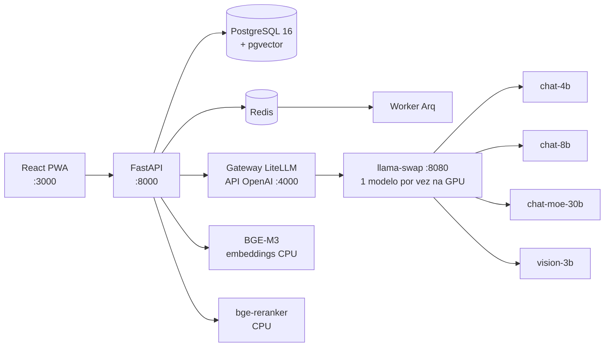

# Chat LLM Local

**Uma plataforma de chat multiusuário com LLMs rodando 100% na própria máquina.** Modelos Qwen3
servidos pela GPU de um notebook, com troca automática entre modelos, login com papéis, histórico
de conversas e um painel de métricas de uso e desempenho. Nenhuma pergunta ou documento sai do computador.


## Destaques

- **Vários LLMs numa GPU de 6 GB**: o llama-swap carrega um modelo por vez e troca sob demanda (4B, 8B, MoE 30B, visão 3B).
- **Uma API para todos os modelos**: o gateway LiteLLM expõe o padrão OpenAI. Usar um modelo de nuvem (ex.: Gemini) é descomentar um bloco no `config/litellm.yaml`, sem tocar no código.
- **Multiusuário de verdade**: login com senha Argon2 + JWT, papéis `admin` / `curador` / `usuario`, e cada usuário só vê os próprios dados.
- **Observabilidade embutida**: cada resposta grava tempo até o primeiro token, tokens/s, tokens de entrada e saída e o feedback 👍/👎. O painel mostra tudo por modelo, dia, hora e usuário, com exportação CSV.
- **Instalável no celular** como PWA.

## Desempenho medido

Medianas do uso real registrado no próprio banco (amostra pequena: 9 respostas), numa **RTX 3050 Laptop de 6 GB**:

| Modelo | Arquivo | Onde roda | 1º token | Velocidade |
|---|---|---|---|---|
| `chat-4b` (padrão) | Qwen3-4B-Instruct-2507 Q4_K_M | 100% GPU | **0,4 s** | **~50 tokens/s** |
| `chat-8b` | Qwen3-8B Q4_K_M | GPU + parte na CPU (não cabe em 6 GB) | 1,4 s | ~16 tokens/s |

O 4B é ~3× mais rápido porque cabe inteiro na VRAM; o 8B divide camadas com a CPU. Esse é o tipo
de troca (qualidade × velocidade) que o painel de métricas ajuda a decidir.

## Arquitetura



## Status

| Fase | Entregue |
|---|---|
| **Sprint 0: fundação** | 9 serviços em Docker, modelos na GPU com troca automática, gateway, esquema do banco (14 tabelas), chat com streaming, PWA |
| **Sprint 1: multiusuário** | Login, papéis, painel de admin (usuários e modelos), conversas por usuário, aba Histórico com métricas e CSV, feedback |
| **Sprint 2: base de conhecimento (RAG)** | 🚧 **Em andamento.** Prontos: embeddings BGE-M3 (1024 dim.), reranker e as tabelas `documents`/`chunks` com pgvector. Falta: ingestão de documentos e busca integrada ao chat |
| **Próximos** | OCR de documentos, memória de longo prazo, acesso pelo celular (Tailscale + HTTPS) |

---

## O que sobe

| Serviço | Função | Porta (só local) |
| --- | --- | --- |
| `llm` | llama-swap + llama-server (GPU): `chat-4b`, `chat-8b`, `chat-moe-30b`, `vision-3b` | 8080 |
| `embed` | BGE-M3 na CPU (embeddings 1024 dim.) | interna |
| `rerank` | bge-reranker-v2-m3 na CPU | interna |
| `gateway` | LiteLLM, API compatível com OpenAI para todos os modelos | 4000 |
| `db` | PostgreSQL 16 + pgvector (14 tabelas + dados iniciais) | 5432 |
| `redis` | fila dos workers | interna |
| `api` | backend FastAPI | 8000 |
| `worker` | jobs assíncronos (Arq) | — |
| `web` | interface React/PWA + proxy da API | **3000** |

Todas as portas ficam em `127.0.0.1`. O acesso pelo celular (Tailscale + HTTPS) entra no Sprint 4.

---

## Instalação (passo a passo)

### 1. No Windows (uma vez)

1. Atualize o **driver NVIDIA** do Windows (Game Ready ou Studio recente). Não instale driver dentro do WSL.
2. No PowerShell como administrador:
   ```powershell
   wsl --install -d Ubuntu-24.04
   ```
3. Copie `windows/.wslconfig` para `C:\Users\<seu-usuario>\.wslconfig` (ajuste `processors`).
4. Se o **Docker Desktop** estiver instalado: abra-o > **Settings > Resources > WSL integration**,
   desmarque o **Ubuntu** e clique em **Apply & restart** (ou desinstale o Docker Desktop).
   Depois rode `wsl --shutdown` no PowerShell. Vamos usar o Docker Engine direto no Linux,
   e o `setup_ubuntu.sh` remove os links que o Docker Desktop deixa no Ubuntu.
5. Configure a energia para **não suspender na tomada**.

### 2. No Ubuntu (WSL)

```bash
# ativar systemd (necessário para o Docker)
printf '[boot]\nsystemd=true\n' | sudo tee /etc/wsl.conf
```
No PowerShell: `wsl --shutdown`, e abra o Ubuntu de novo.

Copie o projeto para **dentro do disco do Linux** (não use `/mnt/c`, é bem mais lento):
```bash
mkdir -p ~/projetos && cd ~/projetos
# se o zip está em Downloads do Windows:
cp /mnt/c/Users/<seu-usuario>/Downloads/chat-local-sprint0.zip .
unzip chat-local-sprint0.zip && cd chat-local
```

### 3. Instalar Docker, toolkit NVIDIA e CLI do Hugging Face

```bash
bash scripts/setup_ubuntu.sh
newgrp docker        # ou feche e abra o terminal
```
O script termina rodando `nvidia-smi` dentro de um container. Se a GPU aparecer, está tudo certo.

### 4. Segredos

```bash
cp .env.example .env
nano .env            # troque POSTGRES_PASSWORD, LITELLM_MASTER_KEY e JWT_SECRET
                     # dica: openssl rand -hex 24
```

### 5. Baixar os modelos (~33 GB; ~10 GB sem o 8B e o MoE)

```bash
bash scripts/baixar_modelos.sh
# ou, começando só com o essencial (4B, visão, embeddings, reranker):
SEM_8B=1 SEM_MOE=1 bash scripts/baixar_modelos.sh
```

| Nome fixo | Modelo padrão | Tamanho aprox. |
| --- | --- | --- |
| `chat-4b.gguf` (padrão) | Qwen3-4B-Instruct-2507 Q4_K_M | 2,5 GB |
| `chat-8b.gguf` | Qwen3-8B Q4_K_M (parte na CPU em 6 GB) | 5 GB |
| `chat-moe-30b.gguf` | Qwen3-30B-A3B Q4_K_M | 18 GB |
| `vision-3b.gguf` + `mmproj` | Qwen2.5-VL-3B Q4_K_M | 3 GB |
| `embed-bge-m3.gguf` | BGE-M3 Q8_0 | 0,6 GB |
| `rerank-bge-v2-m3.gguf` | bge-reranker-v2-m3 Q8_0 | 0,6 GB |

Para trocar qualquer modelo, rode o script com outro repositório, por exemplo:
`CHAT_REPO=org/OutroModelo-GGUF CHAT_PAT="*Q4_K_M.gguf" bash scripts/baixar_modelos.sh`.
Vale conferir no Hugging Face se há versões mais novas das famílias Qwen.

### 6. Subir tudo

```bash
docker compose up -d --build
docker compose ps
```

### 7. Testar

```bash
bash scripts/smoke_test.sh            # chat-4b (padrão); pede login de admin p/ embed e rerank
SMOKE_LOGIN=seu-login bash scripts/smoke_test.sh   # já informa o login; só a senha é perguntada
bash scripts/smoke_test.sh chat-8b
bash scripts/smoke_test.sh chat-moe-30b
```
Abra **http://localhost:3000** no navegador do Windows. O ponto colorido no topo mostra o estado
dos serviços. Abaixo de cada resposta aparecem o tempo até o primeiro token e os tokens/s.

### 8. Medir VRAM (critério de aceite do Sprint 0)

Em outro terminal, enquanto conversa com cada modelo:
```bash
bash scripts/medir_vram.sh
```
Anote no documento de arquitetura (tabela "Orçamento de VRAM"): VRAM usada, tokens/s e tempo até o
primeiro token para `chat-4b`, `chat-8b` e `chat-moe-30b`.

**Ajustes para 6 GB** (em `config/llama-swap.yaml`, depois `docker compose restart llm`):
- `chat-moe-30b`: `--n-cpu-moe 48` deixa todos os especialistas na RAM. Diminua (44, 40...) enquanto o pico de VRAM ficar abaixo de ~5,6 GB: fica mais rápido.
- `chat-8b`: `-ngl 28` deixa parte das camadas na CPU. Suba o número enquanto couber.
- `chat-4b`: se faltar VRAM, reduza `-np 3` para `-np 2` e `-c 24576` para `-c 16384`.

---

## Verificação da instalação

- `docker compose ps` com todos os serviços em execução
- `bash scripts/smoke_test.sh` sem falhas
- Chat respondendo com streaming em http://localhost:3000
- Tempo até o primeiro token e tokens/s visíveis abaixo de cada resposta e na aba Histórico

## Comandos úteis

```bash
docker compose logs -f llm          # ver carga dos modelos
docker compose logs -f api
docker compose restart gateway      # depois de editar config/litellm.yaml
docker compose exec db psql -U chatlocal -d chatlocal -c '\dt'
docker compose down                 # parar (dados ficam nos volumes)
docker compose down -v              # APAGA banco e arquivos (recria o esquema na próxima subida)
```

## Problemas comuns

| Sintoma | Causa provável | O que fazer |
| --- | --- | --- |
| `setup_ubuntu.sh` diz que o Ubuntu usa o Docker Desktop | Integração WSL do Docker Desktop ligada | Desmarque o Ubuntu em Docker Desktop > Settings > Resources > WSL integration, `wsl --shutdown`, rode de novo |
| `docker pull` falha com `docker-credential-desktop.exe` | Configuração herdada do Docker Desktop | Apague a linha `credsStore` de `~/.docker/config.json` (o setup já faz isso) |
| Erro CUDA ao carregar modelo (`no kernel image`, `unsupported`) | Driver NVIDIA antigo | Atualize o driver do Windows para a versão mais recente e rode `wsl --shutdown` |
| `nvidia-smi` não existe no Ubuntu | Driver do Windows antigo | Atualize o driver NVIDIA no Windows e rode `wsl --shutdown` |
| Container não vê a GPU | Toolkit não configurado | `sudo nvidia-ctk runtime configure --runtime=docker && sudo systemctl restart docker` |
| `llm` reinicia com erro de caminho `/app/...` | Layout da imagem do llama-swap mudou | `docker run --rm --entrypoint ls ghcr.io/mostlygeek/llama-swap:cuda -la /app` e ajuste `entrypoint` no compose e `cmd` no `llama-swap.yaml` |
| Erro de opção desconhecida no llama-server (`--reasoning-budget`, `--n-cpu-moe`) | Versão da imagem | Atualize: `docker compose pull llm`; se persistir, remova a opção |
| Falta de memória ao carregar o MoE | WSL com pouca RAM | Confira o `.wslconfig` (`memory=48GB`) e `free -h` no Ubuntu |
| Primeira resposta muito lenta | Modelo sendo carregado na GPU | Normal na primeira chamada ou após trocar de modelo |
| Após reiniciar o Windows, um container fica `Exited`/`Created` com erro *"mount a directory onto a file"* | O Docker Desktop subiu antes de o disco do WSL estar acessível e não achou o arquivo de configuração | `bash scripts/religar.sh` recria só os containers com erro. Para rodar sozinho a cada boot: `bash scripts/instalar_religar.sh` (pede sudo uma vez) |
| `smoke_test.sh` mostra embed/rerank como PULADO | Desde o Sprint 1 essas rotas exigem login de admin | Rode num terminal (ele pergunta login e senha) ou defina `SMOKE_LOGIN` e `SMOKE_SENHA` |
| `embed` falha com texto longo | Lote menor que o texto | Já configurado com 8192; reduza o tamanho dos chunks |

## Projetos relacionados

- [nlp-sql](https://github.com/rcruzjs/nlp-sql): perguntas em português viram SQL no PostgreSQL, usando os modelos servidos por este projeto.

## Autor

**Ricardo Cruz**: dados, Machine Learning e engenharia de IA.
